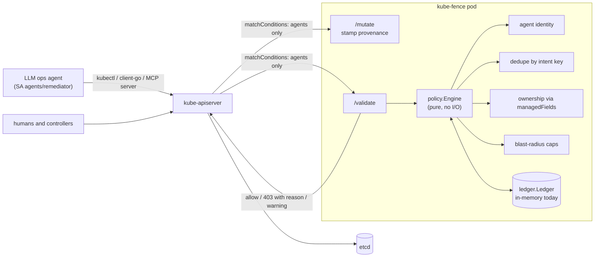

# kube-fence

A Kubernetes admission webhook that puts an idempotency ledger, field-ownership checks, and blast-radius limits in front of every write an AI operations agent makes to your cluster.

## The problem

LLM-driven ops and remediation agents are getting write access to production clusters. They fail differently from human operators and from ordinary controllers:

- **Retries duplicate irreversible effects.** An agent calls `delete pod db-0`, the tool call times out, and the agent retries. The first call succeeded, the StatefulSet recreated `db-0`, and the retry kills the fresh pod. A `create` of a migration Job with `generateName` gets a new random name every time, so the API server happily runs the migration twice. Kubernetes has no request-level idempotency key, and the agent cannot tell "failed" from "succeeded but I never heard back".
- **Agents fight controllers.** An agent "fixes" latency by setting `spec.replicas: 10` on a Deployment that an HPA owns, or bumps an image that Argo CD or Flux applied from Git. The controller reverts it seconds later, the agent sees the problem again, and the two loop.
- **Mistakes are fast and wide.** A confused agent can delete every pod in a namespace or scale a service to zero faster than a human can read the alert.

RBAC answers "may this identity write this resource". It cannot answer "has this exact effect already happened", "who else owns this field", or "how much has this agent changed in the last ten minutes". kube-fence answers those at the API server, which is the one choke point every client (kubectl, client-go, an MCP server, a shell script the agent wrote) must pass through.

## What it does (milestone 1)

| Guard | Behaviour |
|---|---|
| Agent identity | Requests from configured ServiceAccounts (`ns/name`, `ns/*`), users, or groups are agent writes. Everything else passes untouched. |
| Effect ledger | Every allowed agent write is recorded under an idempotency key: the `kube-fence.io/intent-id` annotation if present, else a SHA-256 of verb + GVR + subresource + namespace + name + field-level change set. A repeat within the window is denied with `duplicate irreversible effect`. |
| Ownership guard | Uses `metadata.managedFields` of the stored object to deny agent changes to fields owned by protected managers (HPA via `/scale`, `argocd-controller`, `kustomize-controller`, `helm-controller`, ...), unless the request itself sets `kube-fence.io/allow-ownership-override`. |
| Blast radius | Per-namespace caps: max agent deletes per window and max replica change per write (including writes through `/scale`). |
| Audit mode | `mode: audit` evaluates and records everything but always allows; would-be denials come back as `kubectl` warnings and structured logs. |
| Provenance | A mutating webhook stamps `kube-fence.io/last-agent-write` (`{agent, intent, at}`) on objects agents create or change. |

## Architecture



Layout:

```
cmd/kube-fence      TLS server entrypoint
internal/webhook    AdmissionReview <-> policy.Request adapter, JSON patch for provenance
pkg/policy          pure decision engine: identity, diff, intent keys, managedFields, limits
pkg/ledger          Ledger interface + in-memory implementation
deploy/             Deployment, Service, webhook configs, cert script, example agent RBAC
hack/e2e.sh         scenario script run against kind
```

## Quickstart

Requires Go 1.27, Docker, kind, kubectl.

```sh
make test        # go test -race ./...
make build       # bin/kube-fence
make kind-up     # kind cluster "kube-fence", build + load image, certs, deploy, register webhooks
make e2e         # run hack/e2e.sh against the cluster
make kind-down
```

Try it by hand. The example RBAC makes `agents/remediator` an editor of namespace `demo`; impersonation stands in for a real agent:

```sh
alias agent='kubectl --context kind-kube-fence --as=system:serviceaccount:agents:remediator -n demo'
kubectl --context kind-kube-fence apply -f deploy/examples/agent-rbac.yaml
kubectl --context kind-kube-fence -n demo create configmap cfg --from-literal=a=1

agent delete configmap cfg            # allowed and recorded
kubectl --context kind-kube-fence -n demo create configmap cfg --from-literal=a=1
agent delete configmap cfg            # denied: duplicate irreversible effect
```

```
Error from server (Forbidden): admission webhook "validate.kube-fence.io" denied the request:
kube-fence denied agent write: [duplicate-effect] duplicate irreversible effect: DELETE on
configmaps demo/cfg matches intent sha256:edd2aa51b95351e3e09d3303 already applied by
system:serviceaccount:agents:remediator 0s ago; if this is a new action, set a fresh
kube-fence.io/intent-id annotation
```

## Policy config

Mounted from the `kube-fence-config` ConfigMap (YAML or JSON, unknown fields rejected). Omitted fields fall back to defaults.

```yaml
mode: enforce                 # or audit
agents:
  serviceAccounts: ["agents/*", "ops/remediator"]
  users: ["llm-operator@example.com"]
  groups: ["kube-fence:agents"]
dedupe:
  window: 10m                 # how long an intent key blocks repeats
ownership:
  overrideAnnotation: kube-fence.io/allow-ownership-override
  protectedManagers:
    - manager: kube-controller-manager
      subresource: scale      # HPA writes replicas through /scale
    - manager: argocd-controller
    - manager: kustomize-controller
    - manager: helm-controller
    - manager: "my-operator-*"  # trailing wildcard
limits:
  default:
    maxDeletes: 5             # agent deletes per window per namespace
    window: 10m
    maxReplicaDelta: 5        # |new - old| replicas per write
  namespaces:
    prod:
      maxDeletes: 1
      maxReplicaDelta: 2
```

Agent contract, in one line each:

- Put a fresh `kube-fence.io/intent-id` (a UUID or ticket id) on every distinct action and reuse it on retries.
- To deliberately override a controller, set `kube-fence.io/allow-ownership-override: "<reason>"` in that request. A value already on the object does not count.

The `matchConditions` in `deploy/webhooks.yaml` only send `system:serviceaccount:agents:*` requests to the webhook. Keep that expression in sync with (or broader than) `agents:` in the config.

## End-to-end run

`make kind-up && make e2e` on 2026-11-11 (kind v0.33.0, node image `kindest/node:v1.37.0`): **21 passed, 0 failed**. The scenarios:

| Scenario | Result |
|---|---|
| Agent sets `spec.replicas` on a Deployment whose replicas were last written through `/scale` by `kube-controller-manager` | denied, `field-ownership` |
| Agent changes an image applied by `argocd-controller` via server-side apply | denied, `field-ownership` |
| Same change with an override annotation set in the request | allowed |
| Argo re-syncs, agent re-applies the same image | denied, `duplicate-effect` |
| Agent changes the image again, override annotation still on the object from before | denied, `field-ownership` |
| Agent deletes StatefulSet pod `db-0`, waits for it to be recreated, deletes again | allowed, then denied `duplicate-effect` |
| `generateName` create with `intent-id: ticket-7` twice, then `ticket-8` | allowed, denied, allowed |
| `generateName` create without an intent id, retried | allowed, then denied (content key) |
| `kubectl scale --replicas=10` from 1 through `/scale` with cap 3 | denied `replica-delta`; scaling to 3 allowed |
| Fourth agent delete in `demo` within 10m with cap 3 | denied `delete-limit`; the same delete by a human is allowed |
| Repeating an absolute scale to the current value | allowed (no-op, not recorded) |
| Audit mode, duplicate pod delete | allowed with `Warning: kube-fence (audit) would deny ...` |

## Roadmap

**M1: working guard (done)**
- [x] Agent identity from ServiceAccounts, users, groups
- [x] Effect ledger interface with in-memory store, explicit intent ids and content-hash keys, dedupe window
- [x] Ownership guard over `managedFields` with per-request override
- [x] Per-namespace delete and replica-delta caps
- [x] Audit mode with API warnings and structured logs
- [x] Provenance annotation from a mutating webhook
- [x] Table-driven unit tests, deploy manifests, cert script, kind e2e, CI

**M2: durable and HA**
- [ ] CRD-backed ledger (`AgentEffect` objects) with optimistic concurrency so several replicas share one ledger and restarts keep history
- [ ] HPA-aware ownership: resolve `HorizontalPodAutoscaler.scaleTargetRef` instead of trusting `managedFields` alone (see the gap below)
- [ ] Ownership checks on `/scale` requests by reading the parent object
- [ ] Config hot reload

**M3: correct under unknown outcomes**
- [ ] Reconcile-on-unknown: record entries as `pending` at admission, confirm them when the object reaches the admitted `resourceVersion`, and release keys for writes that never landed
- [ ] Ledger query endpoint so an agent can ask "did intent X happen?" before retrying

**M4: observability and agent integration**
- [ ] Prometheus metrics: decisions by rule, agent, namespace
- [ ] OpenTelemetry spans linking intent ids to the agent's trace
- [ ] MCP tool adapter: Kubernetes write tools that attach intent ids automatically and return kube-fence denials as structured tool errors

## Known gaps

- The ledger is in memory and per pod. A restart forgets history, and more than one replica would split it, so the Deployment runs one replica with `failurePolicy: Fail` for agents only.
- Entries are recorded when the webhook admits a write, not when etcd commits it. If a later admission step or the storage write fails, a legitimate retry is denied until the window passes. M3 fixes this.
- `/scale` requests carry a `Scale` object with no `managedFields`, so they get replica caps and dedupe but no ownership check.
- On the kind v1.37.0 cluster, a Deployment created by server-side apply **without** `spec.replicas` got no `managedFields` entry for `spec.replicas` after `/scale` writes. GitOps setups that leave replicas to the HPA look exactly like that, so the ownership guard cannot see the HPA there. The e2e uses a `kubectl create` Deployment for the HPA case; M2 reads HPA objects directly.
- Content keys for updates hash the new values. An agent that recomputes a relative change ("add 2 replicas") on retry produces a different key; only an intent id catches that.

## What I learned / design decisions

- **The API server is the right enforcement point.** A proxy in front of an MCP server only sees MCP traffic, and agents also shell out to `kubectl`. Admission sees every write regardless of client.
- **Absolute writes are already idempotent.** Re-sending the same desired state is an empty diff, so kube-fence allows it without recording. The ledger matters for deletes, creates, and relative recomputes, which is exactly where retries hurt.
- **The requester is not part of the key.** Two agents reacting to the same alert and deleting the same pod collide on purpose.
- **Read ownership from `oldObject`.** For updates the API server has already rewritten `managedFields` on the incoming object, so the new object shows the agent as owner of whatever it touched.
- **`generateName` is resolved before admission.** My first unit test passed an empty name; the e2e showed the request already carries the random name, which made every retry look new. Creates with `generateName` are now keyed by the prefix.
- **Ownership moves on update.** After an override, the GitOps tool no longer owns the field until it re-syncs; the e2e simulates that re-sync instead of assuming ownership is sticky.
- **Overrides are per request, intent ids are not.** An override left on the object would silently disable the guard for every later write, so only an override that this request sets counts. Intent ids have to survive retries, so they are always honoured, and the docs ask agents to use a fresh one per action.
- **Fail closed, but only for agents.** `matchConditions` keep human and controller traffic away from the webhook entirely, so `failurePolicy: Fail` cannot take down the cluster's normal write path.
- **Keep the policy pure.** `pkg/policy` has no I/O: a request, a ledger interface, and a clock go in, a decision comes out. That keeps the table-driven tests fast and deterministic and leaves the storage backend swappable.

More detail and the tradeoffs behind each choice: [docs/DESIGN.md](docs/DESIGN.md).

## License

Apache-2.0, see [LICENSE](LICENSE).
